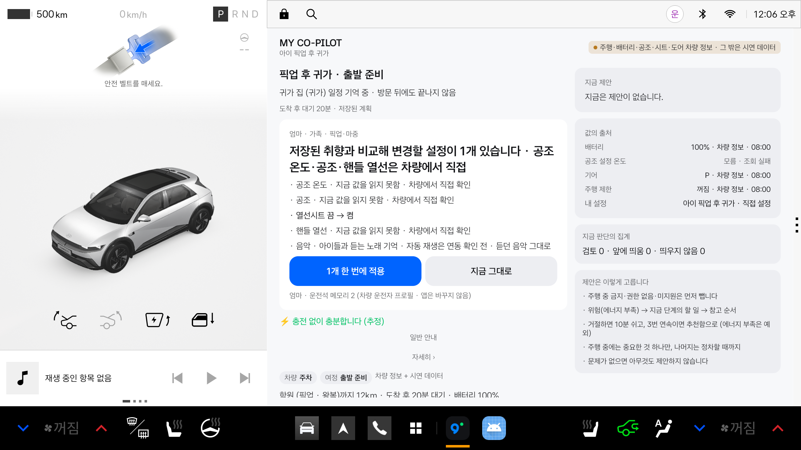
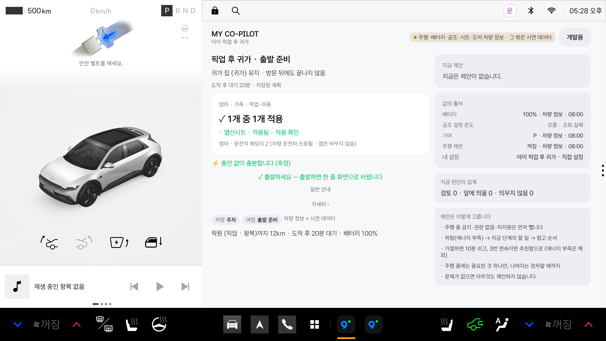
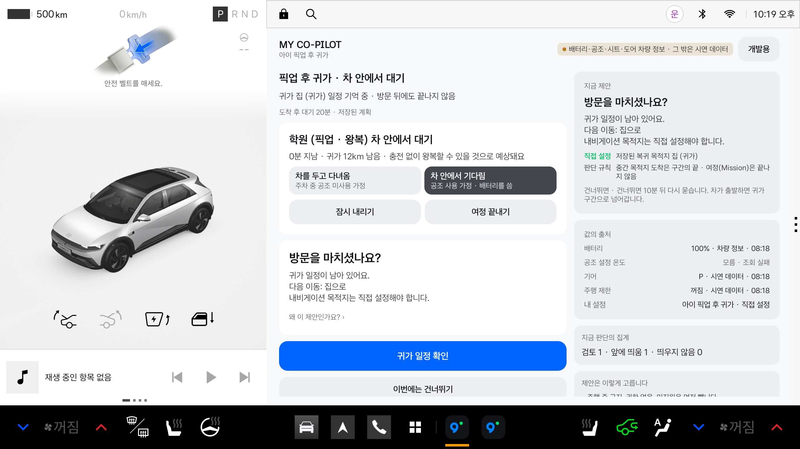
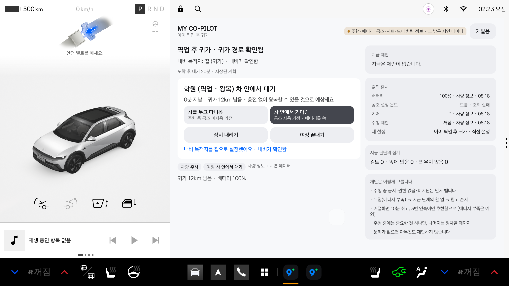
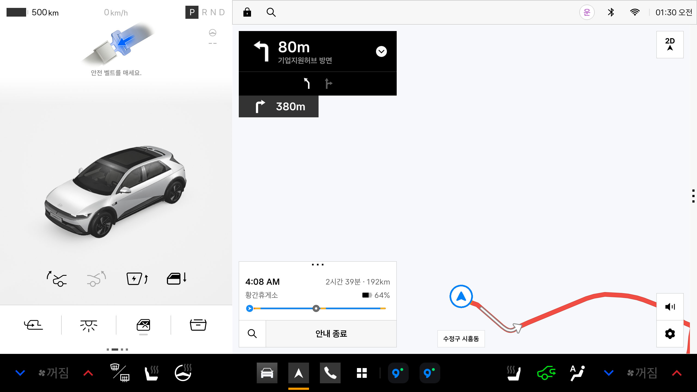

# MY CO-PILOT

> **목적지를 알려주는 차에서, 목적을 달성하도록 돕는 차로.** — MY CO-PILOT · Journey OS
> 차량 상태 · 내비게이션 · 외부 서비스의 정보를 연결해 운전자의 실제 이동 목표(약속 시간에 맞춘 방문 · 픽업 후 귀가 · 가족 장거리)를 달성하는 데 필요한 다음 행동을 하나의 결정으로 제안하고, 승인하면 실행한 뒤 반영 결과까지 다시 읽어 확인하는 Pleos Connect 앱입니다.

현대자동차그룹 차량용 앱 개발 공모전 2026 출품작 · Pleos Connect.
제품 정의는 [`docs/my-copilot/v7/PRODUCT-VISION-V7.md`](docs/my-copilot/v7/PRODUCT-VISION-V7.md)에 있습니다.

| 경험 | 상태 |
|---|---|
| **ARRIVE READY** — 약속 시간 + 이동 + 주차 + 방문을 한 번에 (모든 동력원 · 신규 주력) | [개발 중] · 데이터 관문 A·B·C 통과 ([관문](docs/my-copilot/v7/ARRIVE-READY-FEASIBILITY.md)) · 판단 엔진 구현 · 개발 브랜치(`arrive-ready-dev`)에서 실제 주차 데이터 + 내비 소요 시간 → 추천 → 승인 → 내비 목적지 반영 → 재조회까지 [에뮬] (E32, 2026-11-13) · **출품 APK 미포함** · 조작 감소는 측정 전 |
| **JOURNEY RECOVERY** — 계획의 근거가 바뀌면 결과가 달라질 때만 다시 제안 | 충전소 상태 · 배터리 변화 재판단 [에뮬] · 안내 중인 주차장 정보 변화 재판단 [개발 중] (만차는 [시연]) |
| **ENERGY & STOP** — 충전과 휴식을 한 결정으로 (전기차 특화) | [에뮬] · [실 API] |

아래 세 축은 이 경험들을 만드는 방식입니다.

## 세 축

| 축 | 하는 일 |
|---|---|
| **Multi-Service Integration** | 떨어져 있는 서비스의 정보를 하나의 이동 판단에 씁니다. 앱을 띄워 주는 런처가 아닙니다 |
| **Context-Aware Assistance** | 운전자 × 탑승 조합 × 이동 목적으로 상황을 이해하고, 지금 필요한 행동 **하나**만 제안합니다 |
| **One-Action Execution** | 승인하면 실행하고, 차량·내비 값을 **다시 읽어** 반영을 확인합니다. 못 하는 것은 직접 하도록 안내합니다 |

공통 기반: **Mission**(이동 목적·남은 일정 기억) · **개인화**(운전자·동승자 취향) · **Decision Engine**(근거 등급·신선도·단위를 붙인 결정 하나) · **Safety Gate**(자동 변경 금지 · 주행 중 한 줄과 음성만).
전기차 에너지 판단은 전기차에서만 켜지는 하위 모듈입니다.

## 무엇이 실제로 확인됐나

증거 등급: **[에뮬]** Pleos Connect Emulator v2.1.0 실측 · **[실 API]** 외부 API 실호출 · **[시연]** 시연 데이터 · **[개발 중]** 개발 브랜치에서 확인 · 출품 APK 미포함 · **[미구현]** 로드맵.

| 고리 | 등급 |
|---|---|
| 배터리 잔량·용량 수신(원시 Wh → kWh 정규화) | [에뮬] |
| 공조 온도 · 시트 열선·통풍 조회와 설정 → 변경 알림 → 재조회 · 읽지 않는 값(공조 전원 · 핸들 열선)은 '지금 값을 읽지 못함'으로 표시(E33) | [에뮬] |
| 같은 조정이 세 번 반복되면 저장 후보를 한 번 제안 | [에뮬] |
| 픽업 Mission — 도착 뒤에도 귀가 기억 · 강제 종료·재부팅 뒤 복원 | [에뮬] (도착 전환은 모의 주행 — 이 에뮬레이터에 속도 신호가 없음) |
| 내비 "집으로 안내" 요청 → 시작 알림 → 목적지 재조회 | [에뮬] |
| 내비 경유지 추가 → 경로 반영 → 목록 재조회 · 슬롯이 차면 교체할 칸을 물음 | [에뮬] (`onWaypointChanged(ADD)` 7.3초 · 2026-11-10) |
| 공공 충전소 정보·실시간 상태(경부선 부산 방향 8곳 · 충전기 77대) | [실 API] · 앱에서 실데이터 추천 → 경유지 승인 → 재조회까지 [에뮬] (2026-11-10) |
| 휴게소 가족 시설 | [시연] |
| 서울 시영 주차 정보 · 주차장별 내비 소요 시간 → 추천 → 내비 반영 | [실 API] · [에뮬] — [개발 중] (출품 APK 미포함) |
| 일정 · 장소 · 날씨 · 주유 · 서울 밖 주차 | [미구현] |

## 화면 (Pleos Connect Emulator, 오른쪽이 앱 창)

| 픽업 Mission · 출발 준비 | 열선 설정 → 재조회 확인 | 대기 중 귀가 제안 | 귀가 안내 → 목적지 재조회 | 경유지 → 내비 반영 |
|---|---|---|---|---|
|  |  |  |  |  |

캡처 속 휴게소 충전기·위치 값은 시연 데이터입니다(화면에 늘 표시됩니다).

## 설치 · 빌드

### 설치해서 보기

```bash
adb install apk/플루톤_MY-CO-PILOT_release.apk
```

- **Pleos Connect 에뮬레이터·차량**(Automotive 기기)에서는 Vehicle SDK · NaviHelper · AAOS Car API에 붙습니다. 화면 위에 어떤 값이 차량 정보이고 어떤 값이 시연 데이터인지 표시됩니다.
- **그 밖의 기기**에서는 차량 신호가 모의 값으로 대체되고, 그렇게 표시됩니다. 실제 값과 시연 값을 섞어 말하지 않습니다.
- 충전소 실데이터는 개발 PC의 중계 서버(키 보관·캐시·호출 제한)를 거칩니다. 중계 서버가 없으면 앱은 "충전소 상태를 받지 못했어요"라고 말하고 추천하지 않습니다 — 값을 지어내지 않습니다.

### 소스에서 빌드

```bash
cd android
./gradlew :copilot:assembleRelease   # → copilot/build/outputs/apk/release/copilot-release.apk
```

- JDK 17 · Android SDK(platform 34 · build-tools 34) — `android/local.properties` 에 `sdk.dir=...`
- Pleos SDK 는 공식 공개 Maven(`https://nexus-playground.pleos.ai/repository/maven-releases/`)에서 Gradle 이 받습니다.
- 서명 키(`android/keystore.properties`)가 없으면 debug 키로 서명합니다 — 클론해서 바로 빌드됩니다.
- 충전소 중계 서버: `node node_modules/tsx/dist/cli.mjs scripts/charger-proxy/server.ts` (공공데이터포털 인증키 필요, 저장소에 넣지 않음) → `adb reverse tcp:8787 tcp:8787`.

### 테스트

| 무엇 | 명령 | 결과 (2026-11-13) |
|---|---|---|
| 판단 엔진 Kotlin | `cd core && gradle test` | 264 통과 |
| 같은 규칙의 TypeScript 거울 | `npm test` | 211 통과 |
| 두 언어 공통 계약(같은 입력 → 같은 답) | `contracts/v6/*.tsv` — 양쪽 테스트가 같은 파일을 읽음 | 통과 |

## 구조

```
android/copilot/     MY CO-PILOT 차량용 앱(Compose) — 판단은 core 를, 차량 연결은 어댑터를 소스 그대로 컴파일
core/                판단 엔진 — 순수 Kotlin(Android 의존 없음) + 단위 테스트
  assistant/           여정 · Mission · 상황(운전자×탑승×목적) · 실내 비교 · 학습 · 제안 하나 · Safety Gate · 통합 결정
src/lib/assistant/   같은 판단의 TypeScript 거울(웹 시연용)
copilot-adapters/    차량 신호 어댑터 — 설정을 바꾸는 호출은 한 파일(PleosCabinControl)에만, 나머지는 읽기 전용 검사
adapters/            Vehicle · NaviHelper 어댑터
scripts/charger-proxy/  충전소 중계 서버 — 키 보관 · 캐시 · 하루 호출 예산 · 거절 응답과 빈 결과를 구분
contracts/v6/        TS·Kotlin 공통 계약 사례
docs/my-copilot/     제품 정의 · 에뮬레이터 확인 기록 · 판단 규칙
docs/data/           휴게소-충전소 연결표(검수본)와 검수 기록
apk/                 제출용 release APK
```

## 지키는 것

- 목적지·경로를 자동으로 바꾸지 않습니다. 경유지가 두 칸 다 차 있으면 기존 것을 지우지 않고 묻습니다.
- 에너지는 항상 범위와 "추정"으로 말합니다. 공식 주행가능거리처럼 보이게 하지 않습니다.
- 주행 중에는 한 줄 상태와 음성만. 비교·설정·승인은 정차 중에만 합니다.
- 동승자는 사용자가 고릅니다(자동 감지가 아닙니다).
- 자체 지도 · 턴바이턴 내비 · 범용 장소 검색 · 범용 챗봇은 만들지 않습니다. 공식 API 데이터는 판단의 입력으로만 씁니다.

## 출처

- 플랫폼 사실: [`docs/research/PLEOS_PLATFORM.md`](docs/research/PLEOS_PLATFORM.md) (공식 문서 · 실물 SDK · 에뮬레이터 실측을 구분)
- 충전소: 한국환경공단 전기자동차 충전소 정보(공공데이터포털 15076352, 공공누리 제1유형) · 휴게소: 한국도로공사 휴게소 전기차 수소차 충전소 현황(15085543)
- 폰트: Asta Sans (SIL OFL 1.1) — `android/app/src/main/assets/licenses/AstaSans-OFL.txt`
